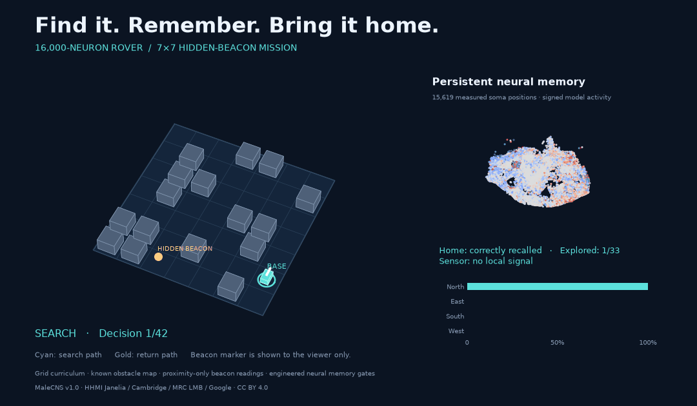

# FruitFlyBrain — rescue rover



*Selected successful replay of the 16,000-neuron model: hidden-beacon search,
pickup, and return to base. Full evaluation results are reported below.*

A local experiment using **16,000 measured MaleCNS v1.0 neurons** to control a
simulated rover in randomized obstacle layouts. Python packages live exclusively
in this directory's `venv/`. The earlier 4,000- and 8,000-neuron experiments remain intact.

## Blender cinematic: AFTERLIGHT

The 16,000-neuron mission now has an editable Blender cinematic: a stylized
fruit fly searches a ruined building, retrieves the beacon, and returns home,
with synchronized recorded brain activity in the top-right inset.

The newer **Into the Ruins** edit uses a low third-person chase camera, a much
smaller fly, taller ruined architecture, and a slower 40-second presentation:

- [Third-person 1080p video](cinematic/mission_16000_chase/afterlight_chase.mp4)
- [Third-person silent version](cinematic/mission_16000_chase/afterlight_chase_silent.mp4)
- [Third-person Blender scene](cinematic/mission_16000_chase/afterlight_chase.blend)
- [Revision details and validation](cinematic/mission_16000_chase/README.md)

The original 25-second overview remains available:

- [1080p video with original sound](cinematic/mission_16000/afterlight.mp4)
- [Silent video](cinematic/mission_16000/afterlight_silent.mp4)
- [Editable Blender scene](cinematic/mission_16000/afterlight.blend)
- [Scene details, provenance, and share caption](cinematic/mission_16000/README.md)

The flight and ruins are cinematic staging around the recorded grid policy.
This does not claim a new trained flight controller. The clip illustrates one
selected success; the aggregate evaluation below still includes all failures.

## Current milestone: 16,000 neurons on a larger rescue map

The expanded model trains on **7×7 maps with 16 blocked cells**, compared with
5×5 maps and six blocked cells in the previous mission. Free space must be
connected. The base and hidden beacon are randomized after obstacle generation;
the beacon starts at least five path moves from the base. A mission permits
192 cardinal moves and succeeds only after collection **and return to base**.
The 33 traversable cells create longer searches, bottlenecks, and detours.

The graph retains every previous neuron and measured edge, and now contains:

| Quantity | Value |
| --- | ---: |
| Neurons | 16,000 |
| Directed measured connections | 3,736,859 |
| Synaptic contacts | 27,441,238 |
| Sensory input neurons | 1,534 |
| Descending readout neurons | 772 |
| Strongly connected components | 1 |

Source files were verified again before extraction. Original IDs and the audit
are in `data/processed/malecns_16000/`. The normalized recurrent matrix takes
1.024 GB in float32 on MPS; gradients, optimizer state, and other allocations
are additional. Training uses the existing project `venv`, with no new packages.

### Independent results: 128 unseen larger maps

**96/128 collected the beacon (75%); 39/128 returned it to base (30.5%).**
There were 32 failures before pickup and 57 after pickup. Successful missions
averaged 37.5 moves. This is a working but unreliable controller for the harder
world; enlarging the connectome has not solved its routing weaknesses.

| Controller / memory control | Collected | Returned |
| --- | ---: | ---: |
| Selected 16,000-neuron model | 96 | 39 |
| Neural memory cleared each decision | 46 | 10 |
| Visited-place memory cleared each decision | 34 | 9 |
| Home memory erased after pickup | 96 | 36 |
| Neural activity silenced | 5 | 0 |
| Reference explorer | 128 | 128 |

The model decoded its remembered base correctly on every evaluated
post-departure decision, but that alone did not produce reliable routes home.
The home-erasure control preserved all 96 pickups and reduced returns by only
three. This small aggregate difference does **not** establish robust use of the
home bank for navigation; the strong memory effect is chiefly in exploration.
The visit bank can also retain information correlated with the starting place,
so erasing the home bank does not erase every possible cue about the base.
No further training or model selection used these final-test outcomes.

- [3D mission animation](docs/assets/mission-16000.gif): deliberately
  selected successful test seed **200089**, 42 moves, pickup at move 35,
  31 of 33 traversable cells visited. This illustration is not the success-rate estimate.
- [Full test results and per-mission outcomes](runs/mission_16000/test/evaluation.json)
- [Development learning curve](runs/mission_16000/learning_curve.png)
- Model: `runs/mission_16000/best.pt`; resumable latest checkpoint:
  `runs/mission_16000/latest.pt`
- Training provenance: `runs/mission_16000/config.json`, `training_summary.json`,
  `metrics.jsonl`, `training.log`, and saved history pools.
- The unselected first test mission remains in `runs/mission_16000/test/replay.json`.

### Training and evaluation

This is a fresh training run on the expanded graph and new observation space;
it does not transplant the old mission checkpoint. Each observation has 110
features: current cell, known obstacle map, local beacon detection, payload,
previous action/blocked status, and a departure cue. The two engineered memory
banks each use 100 sensory-neuron slots; the remaining 1,334 slots encode the
current observation. Memory and sensor signals pass through measured edges to
the action readout. The hidden beacon position and post-departure base position
are never given as policy inputs.

The run uses 4,096 teacher layouts and three rounds of 384 policy-generated
recovery layouts, relabelled by the reference explorer. The teacher receives
only observations and history, not the remote beacon location. There are 6,800
optimizer updates: 3,200 initial updates plus three rounds of 1,200. The first
400 updates freeze graph gains while adapters learn. Training seeds are
100000–105247; checkpoint selection uses 64 development layouts starting at
150000. Final testing uses 128 unseen layouts starting at 200000.

The original 8,000-neuron model's 62.5% result was on the smaller, easier task.
It is **not a controlled neuron-count comparison** with this experiment: both
map difficulty and training budget changed. The curriculum still assumes a
known map, ideal localization, engineered neural memory gates, and legal-action
masking. Collision-free motion follows from that mask. Continuous steering,
camera perception, and biological learning rules are not evaluated here.

The selected checkpoint is update **6,400**, chosen on development outcomes.
The run explored 6,800 optimizer updates in 1,588 seconds (about 26.5 minutes),
excluding initial demonstration generation. Between recovery rounds, training
restarts from the best development weights and optimizer while retaining the
expanded history pool. Consequently, the selected checkpoint is one branch of
that search, not the last update. It changed **2,353,476 measured connection
gains** from initialization. MPS reported 4.22 GB allocated at the end of the
training loop; this is not a measurement of peak memory. All **24 tests pass**,
including expanded-map sensor/memory checks, graph inclusion, and CPU/MPS
agreement. The old saved 8,000-neuron checkpoint still loads exactly.

### Reproduce the expanded experiment

```bash
venv/bin/python -m rover_brain.prepare --neurons 16000 \
  --include-graph data/processed/malecns_8000/graph.npz

# Use a new run directory to preserve the completed experiment.
venv/bin/python -m rover_brain.mission_train --device mps \
  --graph data/processed/malecns_16000/graph.npz \
  --run-dir runs/mission_16000_new --scratch \
  --size 7 --obstacles 16 --max-steps 192 --minimum-distance 5 \
  --layouts 4096 --steps 3200 --dagger-rounds 3 \
  --dagger-layouts 384 --dagger-steps 1200

venv/bin/python -m rover_brain.mission_evaluate --device mps \
  --graph data/processed/malecns_16000/graph.npz \
  --checkpoint runs/mission_16000/best.pt \
  --output-dir runs/mission_16000/test

# Re-record the illustrated successful test mission.
venv/bin/python -m rover_brain.mission_evaluate --device mps \
  --graph data/processed/malecns_16000/graph.npz \
  --checkpoint runs/mission_16000/best.pt \
  --output-dir runs/mission_16000/demo_success \
  --seed 200089 --episodes 1 --modes policy

venv/bin/python -m rover_brain.mission_render \
  --graph data/processed/malecns_16000/graph.npz \
  --replay runs/mission_16000/demo_success/replay.json \
  --output runs/mission_16000/hidden_mission.gif

venv/bin/python -m rover_brain.plot_training --run-dir runs/mission_16000
venv/bin/python -m pytest -q
```

Evaluation and rendering read map dimensions from checkpoint/replay metadata.
Older 5×5 checkpoints remain supported. Resuming training requires the original
graph, map arguments, and run directory, plus `--resume runs/mission_16000/latest.pt`;
`--steps` and DAgger counts then specify additional training. Re-evaluate on a
new held-out seed range if further tuning uses the original final test results.

## Earlier milestone: 8,000-neuron hidden beacon, memory, and return to base

The new **grid-based mission curriculum** trains the rover to explore, detect a
nearby hidden beacon, collect it, and return to its remembered departure cell.
The prior continuous-steering experiments and checkpoints are preserved. This
mission controller is a separate checkpoint; transferring the learned mission
behavior to continuous steering is still future work.

**Independent result: 109 / 128 beacons collected; 80 / 128 complete returns
(62.5%).** The other 48 missions timed out: 19 without collecting the beacon and
29 after collection. All tests used unseen layouts, bases, and beacon placements.

| Policy, same 128 test missions | Collected | Returned to base |
| --- | ---: | ---: |
| Trained policy with neural memory | 109 | 80 |
| All state cleared each decision | 77 | 14 |
| Visited-place memory cleared each decision | 56 | 14 |
| Home memory erased after pickup | 109 | 49 |
| Neural activity silenced | 4 | 0 |
| Reference explorer | 128 | 128 |

The targeted home-memory control has identical search/pickup behavior, then
erases only the home bank. This isolates the return phase. The trained memory
decoder recalled the base cell correctly on every evaluated post-departure
decision, even in failed missions: route/action selection remains a bottleneck.
These ablations establish that this controller uses its memory; they do not
establish superiority of biological wiring or biological realism.

- Successful example selected from the test set, seed 200001:
  `runs/mission_8000/hidden_mission.gif`
- Full test results: `runs/mission_8000/test/evaluation.json`
- Unselected first test episode (picked up, failed to return):
  `runs/mission_8000/test/replay.json`
- Selected model: `runs/mission_8000/best.pt`
- Training history and summary: `runs/mission_8000/metrics.jsonl` and
  `runs/mission_8000/training_summary.json`

### What the agent knows

Each scene is a connected 5×5 grid with six blocked cells. Obstacles are sampled
before choosing the base and beacon, so obstacle placement does not mark the
hidden beacon. The base is randomized over free cells; the beacon is sampled
from connected free cells at least three moves away. The rover knows the
obstacle grid and its current cell (ideal localization). Beacon readings are
limited to the current cell and four immediately adjacent cells. The input
never contains a remote beacon coordinate, bearing, or distance.

The departure cue occurs once, at the start. Thereafter, no base coordinate or
home vector is provided. A payload sensor indicates collection. The policy
chooses one of four cardinal grid moves, with a standard legal-action mask
excluding moves into walls or outside the grid. That mask is computed only from
the observed map and current cell; it does not plan a route. Zero collisions
in this curriculum follow from that mask, not from learned continuous avoidance.
The budget is 96 decisions; completing the mission requires returning with
the payload, not merely discovering the beacon.

### How memory is implemented

The 8,000-neuron rate model has **explicit, engineered memory gates**. Of its
389 input neurons, 100 hold a learned home encoding written at departure,
100 hold a running maximum of learned visited-cell encodings, and 189 receive
the current observation. Memory encodings start from an addressable basis and
are trained. The write/max operations are designed, not discovered by learning
and not asserted to reproduce fly memory physiology.

These neural state slots persist across decisions. Transient neural processing
settles anew through three updates on the measured graph. Home/visit signals
reach the 553 descending readouts through measured edges; there is no separate
planner or memory-to-action bypass. Encoders, connection gains, action readout,
and auxiliary home/visit decoders are trainable. Clamping the memory/sensory
slots is an explicit modeling assumption; not every retained edge is active
or receives a gradient.

The memory update rules allow exact recomputation from historical observations
during training. This avoids costly long-sequence backpropagation on the Mac.
At deployment, the model receives only observations and its own retained state;
it does not receive the training history table. Tests verify equality between
online memory updates and training recomputation, episode reset, and retention
of distinct departure memories under identical subsequent observations.

### Training and reproduction

Training used 2,048 reference-explorer missions plus two rounds of 256 new
policy-generated missions, with teacher relabelling on those histories. The
teacher explores unvisited cells using map/history; it is not told where the
beacon is until a local sensor detects it. After collection it navigates to the
remembered departure cell. No teacher is called for deployed policy actions.

There were 4,800 optimizer updates (first 400 freeze the warm-started graph gains).
The selected policy changed 1,047,054 measured edge gains from the previous
obstacle checkpoint. Neural training/evaluation phases in the training loop
took about 261 seconds; data preparation is additional. MPS driver allocation
at the end was about 2.23 GB, not a peak-memory measurement.

Training layout seeds are 100000–102559. Selection uses 64 development missions
starting at 150000. Final testing uses 128 missions starting at 200000; no further
tuning used these results. All 21 tests pass, including information-leak checks,
memory mechanics, inference without a teacher, and existing graph/physics checks.

```bash
# A new mission-training run; existing checkpoints are protected.
venv/bin/python -m rover_brain.mission_train --device mps --run-dir runs/mission_8000_new

# Re-evaluate the completed mission checkpoint and memory ablations.
venv/bin/python -m rover_brain.mission_evaluate --device mps

# Re-record the illustrated successful test mission.
venv/bin/python -m rover_brain.mission_evaluate --device mps \
  --seed 200001 --episodes 1 --modes policy --output-dir runs/mission_8000/demo_success

# Animate actual decisions and neural activity.
venv/bin/python -m rover_brain.mission_render \
  --replay runs/mission_8000/demo_success/replay.json

# Continue training the existing run, with more recovery missions.
venv/bin/python -m rover_brain.mission_train --device mps \
  --resume runs/mission_8000/latest.pt

venv/bin/python -m pytest -q
```

The animation shows the hidden beacon to the audience, labels the search and
return phases, and uses the policy's recorded decisions and neural activations.
The success example is illustrative; all failures remain in the aggregate test.

## Earlier milestone: continuous obstacle navigation with 8,000 neurons

The expanded graph preserves all original 4,000 neuron identities and contains
**1,644,630 directed edges / 15,610,072 synaptic contacts**. All 8,000 neurons
belong to a single strongly connected component. There are 389 input neurons
and 553 descending readouts. Its audit is
`data/processed/malecns_8000/report.json`.

**Independent test: 77 / 128 solved (60.2%), 27 collisions, 24 timeouts.**
All 128 layouts were unseen during training and checkpoint selection.

| Controller, same 128 test layouts | Reached beacon | Collisions | Timeouts |
| --- | ---: | ---: | ---: |
| Selected 8,000-neuron policy | 77 | 27 | 24 |
| Neural activity silenced | 0 | 0 | 128 |
| Direct-to-beacon steering | 0 | 128 | 0 |
| Global-map teacher (reference only) | 128 | 0 | 0 |

This is a working first obstacle controller, with substantial room to improve
reliability. Successes average 1.32× the start-to-target straight-line distance.
The best checkpoint was selected at update 2,400 using development layouts;
7,000 optimizer updates were explored overall. Fourteen tests passed, including
collision geometry, independent layout seeds, teacher-free policy decisions,
graph integrity and CPU/GPU numerical agreement.

- Successful test example, explicitly selected (seed 80001):
  `runs/obstacles_8000/rover_obstacles.gif`
- First test episode, which collides (seed 80000):
  `runs/obstacles_8000/first_test_collision.gif`
- Full independent metrics: `runs/obstacles_8000/test/evaluation.json`
- Development learning curve: `runs/obstacles_8000/learning_curve.png`
- Selected model: `runs/obstacles_8000/best.pt`

The success animation is an illustrative example, not the success-rate estimate.
The aggregate test includes every failure. No further tuning used this test set.

The arena has six randomized solid rectangular obstacles by default. One
obstacle must block the direct start-to-beacon route. Layout rotations,
reflections, sizes and positions vary; generation checks that a route exists.
Each episode seed identifies the same layout regardless of batch size.
The rover has a conservative 0.34 m footprint, moves 0.15 m per forward action,
and turns 0.24 radians per turn action. A swept-segment test prevents tunnelling
through obstacles. Any collision ends the attempt; the limit is 240 decisions.

The learned controller gets **263 engineered inputs**: 32 clearance rays, a
15×15 local occupancy map at 0.4 m spacing, beacon bearing and distance, and
the previous action. Clearance/map geometry includes the rover footprint.
The simulator supplies this map: camera perception and mapping are not learned.
Beacon direction is available even behind barriers. It is not hidden-source search.

Training begins with global shortest-path teacher demonstrations and then uses
DAgger (teacher labels on states visited by the current policy). The planner
is used to validate generated layouts and provide training labels, and is run
separately as a reference baseline. **The learned policy receives no waypoint,
planner action, or safety override during evaluation.** All decisions pass
through the measured neural network. Activity still resets each decision;
the previous-action input is explicit, not learned long-term memory.

The 8,000-neuron policy is trained from a fresh initialization for the new
observation space; the previous 4,000-neuron checkpoint is preserved. Its
recurrent matrix takes 256 MB in float32 on MPS, with additional allocations
for gradients, optimizer state and training. No new packages were required.

```bash
# Rebuild the expanded graph using the already downloaded official data.
venv/bin/python -m rover_brain.prepare --neurons 8000 \
  --include-graph data/processed/malecns_4000/graph.npz

# Train a new run (choose a new directory rather than overwriting checkpoints).
venv/bin/python -m rover_brain.obstacle_train --device mps --run-dir runs/obstacles_8000_new

# Evaluate the saved best policy on an independent layout set.
venv/bin/python -m rover_brain.obstacle_evaluate --device mps

# Record the illustrated successful episode from the completed experiment.
venv/bin/python -m rover_brain.obstacle_evaluate --device mps \
  --seed 80001 --episodes 1 --modes policy --output-dir runs/obstacles_8000/demo_success

# Render the selected successful example using its corresponding anatomy.
venv/bin/python -m rover_brain.render \
  --graph data/processed/malecns_8000/graph.npz \
  --replay runs/obstacles_8000/demo_success/replay.json \
  --output runs/obstacles_8000/rover_obstacles.gif

# Resume from the latest checkpoint, using the saved demonstration/recovery pool.
venv/bin/python -m rover_brain.obstacle_train --device mps \
  --run-dir runs/obstacles_8000 --resume runs/obstacles_8000/latest.pt

# Optional refinement from the best weights with the latest recovery examples.
venv/bin/python -m rover_brain.obstacle_train --device mps \
  --resume runs/obstacles_8000/latest.pt --restore-best --steps 2400 \
  --dagger-rounds 0 --lr 0.0003 --forward-fraction 0.6

venv/bin/python -m rover_brain.plot_training
```

Training seeds start at 1000 and stay below 40000. Checkpoint selection uses
32 development layouts at seed 50000. The final test defaults to 128 layouts
at seed 80000. Training metrics record collisions and timeouts as well as
success; `best.pt` is selected by development success, then fewer collisions,
then fewer steps. `latest.pt` supports resuming. Final results and the first
test episode replay are in `runs/obstacles_8000/test/`.

The completed experiment used 320 demonstration layouts and three rounds of
96 new recovery layouts (608 distinct training layouts). Recovery observations
are included twice in the pool. The initial training ran 4,600 updates; a
2,400-update refinement did not improve development success, so the earlier
best checkpoint was retained. Both initial and refinement summaries are saved.
The best model is distinct from the latest optimizer checkpoint. Resuming
normally uses latest weights; `--restore-best` explicitly rolls back weights
and optimizer to the best checkpoint while retaining the latest data pool.

This stage demonstrates learned obstacle navigation. A successful comparison
with untrained, silenced and direct-steering controls would not establish that
fly wiring outperforms an equally trained ordinary network.

## Original 4,000-neuron empty-arena run

On this M4 Pro, the initial 300-update imitation-learning run produced:

| Evaluation | Reached beacon |
| --- | ---: |
| Before training | 0 / 32 |
| Trained policy, same episode seeds | 32 / 32 |
| Trained policy, fresh episode seed | 128 / 128 |
| Neural activity silenced, fresh seed | 0 / 128 |

These are small, easy-task evaluations, not evidence of full rescue capability
or an advantage over ordinary neural networks. The teacher is used only to
generate training labels and for a labelled reference evaluation. The learned
policy makes rollout decisions directly, with no teacher or path planner.

- Animation: `runs/beacon_4000/rover_preview.gif`
- Still preview: `runs/beacon_4000/rover_preview.png`
- Model: `runs/beacon_4000/checkpoint.pt`
- Fresh evaluation: `runs/beacon_4000/fresh_evaluation/evaluation.json`
- Recorded decisions and all 4,000 activations: `runs/beacon_4000/fresh_evaluation/replay.json`

The animation interpolates rover geometry between recorded states, while holding
the actual decision-time activity and action probabilities. It shows measured
soma positions for 3,857 neurons; 143 missing positions are omitted, not invented.
Colors represent simulated signed rate activity, not measured biological activity.

## Run locally

Run from this project directory. Activation is optional because these commands
explicitly select the project interpreter. Nothing requires a global pip install.

```bash
# Inspect the recorded performance without retraining.
venv/bin/python -m rover_brain.evaluate --device mps --episodes 128

# Render the recorded episode as a 3D GIF.
venv/bin/python -m rover_brain.render

# A separate, reproducible training run.
venv/bin/python -m rover_brain.train --device mps --steps 600 --run-dir runs/beacon_4000_run2

# Continue that run; --steps means additional optimizer updates.
venv/bin/python -m rover_brain.train --device mps --steps 300 \
  --run-dir runs/beacon_4000_run2 --resume runs/beacon_4000_run2/checkpoint.pt

venv/bin/python -m pytest -q
```

Use `--device auto` to choose MPS if available, or `--device cpu` for the sparse
CPU fallback. Some process sandboxes hide the Mac GPU; a normal terminal exposes
it. Six CPU threads are used for training/evaluation. Initial run MPS driver
allocation at the end was about 1.14 GB; this is **not a measured peak RSS**.
Raw files occupy about 1.1 GB, and the prepared graph is about 3.3 MB compressed.

## Reproduce the data and environment

The existing venv uses ARM64 Python 3.14.6. `requirements-lock.txt` records the
exact packages installed for this experiment; `requirements.txt` lists direct
dependencies and supported version ranges.

```bash
venv/bin/python -m pip install -r requirements-lock.txt
venv/bin/python scripts/download_connectome.py
venv/bin/python -m rover_brain.prepare --neurons 4000
```

The downloader fetches three official files, resumes interrupted downloads,
verifies publisher GCS MD5 checksums and our pinned SHA-256 hashes, then records
URLs, object generations and sizes. Preparation verifies those source hashes
again. It streams the connection table instead of loading all 151 million raw
segment-pair rows into memory. Source provenance is in `data/source-lock.json`.
Rebuilding the graph is deterministic for the recorded environment; GPU training
is seeded but is not promised bitwise reproducible across software/hardware.

## What the 4,000-neuron graph contains

| Quantity | Value |
| --- | ---: |
| Traced, annotated neurons | 4,000 |
| Directed neuron-pair edges | 598,503 |
| Summed synaptic contacts | 7,021,859 |
| Central-brain intrinsic neurons | 3,379 |
| Visual projection neurons | 256 |
| Central-brain sensory neurons | 128 |
| Descending neurons | 237 |
| Neurons on sensory-input → descending-output paths | 4,000 |

Selection starts with traced neurons in those four classes, restricts to the
largest strongly connected candidate component, and seeds the strongest 256
visual projection, 128 central sensory, 128 descending, and 2,000 central-complex
(`class=CX`) neurons. It grows to 4,000 by connectivity to the selected set,
with a 2× preference for central-complex neurons. Ties use original neuron ID.
All measured edges between retained neurons are kept, except self-connections.
This is an engineered, connectivity-biased subset, not an intact biological circuit.

The final graph has one weak component and five strong components. Every neuron
is reachable from input and can reach output. All readouts are within two edges
of an input. The graph audit, role counts, source hashes and selection method are
in `data/processed/malecns_4000/report.json`. Original IDs and annotations are in
`neurons.csv`; arrays and soma coordinates are in `graph.npz`.

## Model and first curriculum stage

```text
8 wall ranges + beacon bearing (sin/cos) + beacon distance
    → trained input adapter (384 sensory neurons)
    → 6 recurrent updates through measured pre → post edges
    → 237 descending neurons
    → forward / turn left / turn right
```

The model uses leaky, signed `tanh` rate units. Initial weights are measured
contact counts divided by each retained neuron's total retained incoming count.
GABA and glutamate sources receive negative signs, other/unknown sources positive
signs: this is a simplifying modeling assumption, not receptor-specific truth.
Each of the 598,503 edges has a trainable, bounded positive gain, preserving its
sign. No learned recurrent connections can appear outside the measured mask.
The encoder and readout are also trained; there is no direct encoder→readout bypass.

The first run updated 474,777 edge gains by more than 1e-7. Some edges do not
receive a task gradient through this finite update horizon. On MPS, a masked
4,000×4,000 matrix provides efficient multiplication (~64 MB for one float32
matrix). The CPU path uses sparse multiplication. Tests check propagation
direction, inhibitory signs, trainable edges, geometric controls, teacher
success, seed repeatability, and real-graph reachability/identity invariants.

Stage 1 deliberately resets neural activity each decision. It **does not yet
test memory**. The agent sees target direction and distance, never camera images.
Training imitates a steering teacher on randomized geometrically valid states.
Evaluation uses separately seeded episodes. Checkpoints contain model and
optimizer state, RNG state, training step, graph hash and configuration.

## Further curriculum stages

1. Improve return-route selection on the larger map; separate failures to find
   the beacon from failures after pickup.
2. Train 8,000- and 16,000-neuron models on identical maps and matched budgets
   before attributing any performance difference to neuron count.
3. Transfer search and remembered-home behavior to the continuous-steering rover.
4. Add unknown maps, noisy localization, moving obstacles, and multiple payloads.
5. Train matched ordinary-network and rewired-network controls before making
   claims about the value of measured fly connectivity.
6. Build a richer interactive 3D scene driven by recorded or live policy actions.

## Attribution

MaleCNS v1.0 is from HHMI Janelia FlyEM, Cambridge, MRC LMB, Google Research and
collaborators, under CC BY 4.0. See [DATA_LICENSE.md](DATA_LICENSE.md) and the
[official download page](https://male-cns.janelia.org/download/). The anatomical
wiring is measured; rover sensors, dynamics, training and control are engineered.
